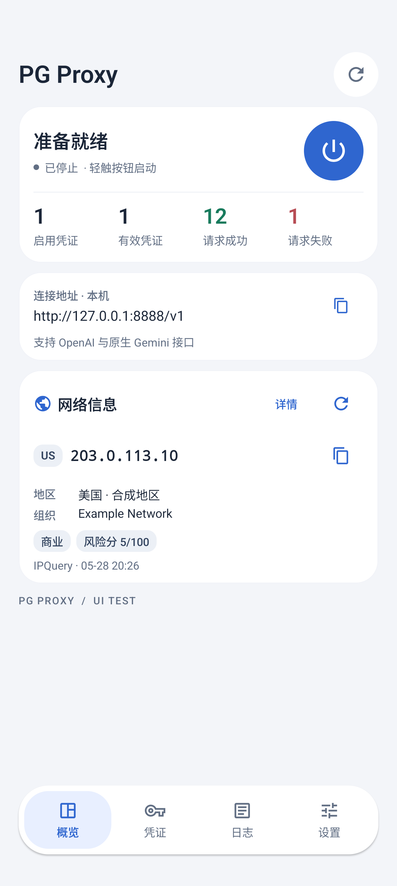
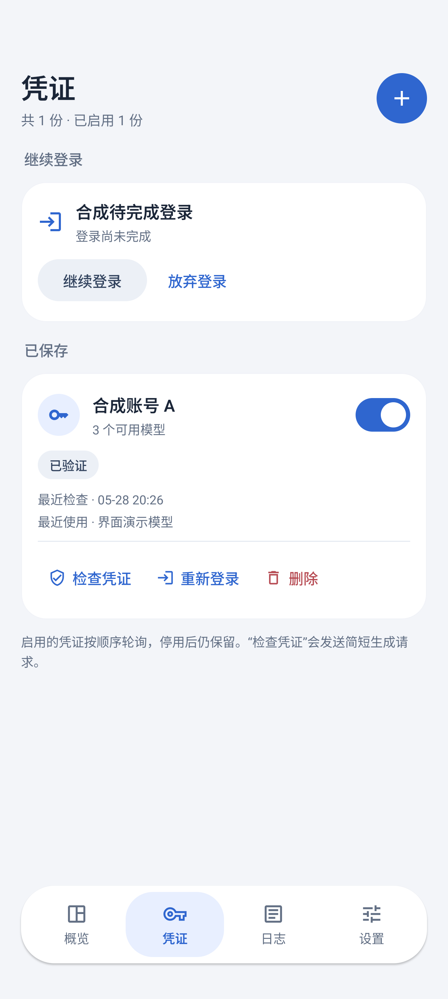
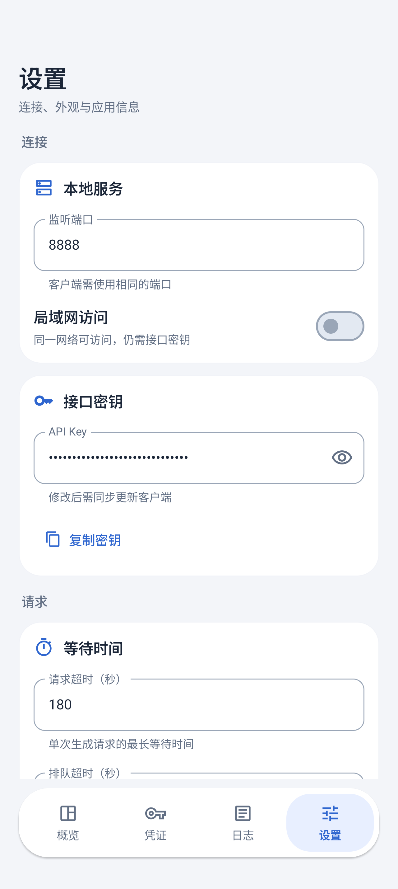

<p align="center">
  
</p>

<h1 align="center">PG Proxy</h1>

<p align="center"><strong>你的 Playground，随时连接。</strong></p>
<p align="center">在 Android 上登录、管理凭证，让熟悉的客户端连接 Google AI Studio Playground。</p>

<p align="center">
  <strong>v0.2.0</strong> · Android 9+ · ARM64 · <a href="LICENSE">MIT License</a>
</p>

<p align="center">
  <a href="https://github.com/print-yuhuan/PG-Proxy/releases/latest"><strong>下载 APK</strong></a> ·
  <a href="#快速开始">快速开始</a> ·
  <a href="docs/MODEL_API.md">接口文档</a> ·
  <a href="docs/FAQ.md">常见问题</a> ·
  <a href="https://github.com/print-yuhuan/PG-Proxy/issues">问题反馈</a>
</p>

---

**PG Proxy** 把登录浏览器、凭证管理和 API 服务集成在一个 Android 应用中，提供 OpenAI 兼容接口与原生 Gemini 生成接口，支持本机及局域网访问。

手机运行时**无需 Termux、Root、电脑或额外后端服务**。项目使用 Google AI Studio Playground 网页会话，是独立社区实现，非 Google 或 Mozilla 官方产品。

<p align="center">
  <a href="docs/assets/overview.png"></a>
  &nbsp;
  <a href="docs/assets/credentials.png"></a>
  &nbsp;
  <a href="docs/assets/settings.png"></a>
</p>

<p align="center"><sub>概览 · 凭证 · 设置　｜　点击查看大图。预览使用合成测试数据，不含真实账号。</sub></p>

## 获取应用

前往 **[GitHub Releases](https://github.com/print-yuhuan/PG-Proxy/releases/latest)** 下载正式签名的 ARM64 APK，并查看对应版本的更新说明、文件校验值和已知限制。

最低支持 **Android 9（API 28）**。源码可构建 `arm64-v8a` 与 `x86_64`，后者主要用于模拟器；当前不支持 32 位设备。想审阅实现或自行打包，可按[构建与维护文档](docs/MAINTENANCE.md)操作。当前显示版本为 **0.2.0**，版本码为 **20**。

**从 0.1.0 升级请注意：0.2.0 使用了新的正式签名，无法直接覆盖旧签名安装包。** 安装前需卸载旧版；卸载会删除本地配置、凭证和浏览器会话。请先记录必要设置，安装新版后重新登录并添加凭证。签名指纹与详情见[安装与签名](docs/MAINTENANCE.md#安装与后续更新)。

**0.2.0 更新重点：**改进客户端请求兼容，忽略不支持的可选参数、处理空值并补全可推断默认值，减少不同客户端默认设置带来的请求失败。具体规则与限制见[客户端兼容说明](docs/CLIENT_COMPATIBILITY.md)。

## 可以做什么

| 功能 | 支持内容 |
| --- | --- |
| **手机登录** | Gecko 与原生 Firefox UA；自动导入会话，可继续未完成的登录 |
| **凭证管理** | 多账号独立会话，启用、禁用、删除、重新登录与真实生成检查 |
| **模型与接口** | 在线目录、模型详情、能力说明、Gemini 分页与 token 计数；流式及非流式生成 |
| **客户端兼容** | 忽略未实现的可选参数，处理空值并补全可推断默认值；保留正文、媒体与工具历史校验 |
| **工具与媒体** | 按模型能力支持函数调用、搜索、代码执行、图像、音视频、PDF 与转写；具体入口有差异 |
| **连接与状态** | 本机／局域网服务，端口和密钥配置，请求统计、网络信息与管理日志 |
| **后台与界面** | 前台通知、后台耗电设置引导、可选 CPU 唤醒、深浅色主题与交互动效 |

生成请求当前**全局串行、按请求轮询凭证**，其他请求进入等待队列；一次生成及其续写始终使用同一凭证。模型在线读取并短时缓存，按已实现能力筛选，不使用固定模型名称允许列表。

目录里的能力说明区分**上游声明、代理实现和具体接口**。兼容接口不代表支持官方 API 的所有功能：Build、Interactions、Live、独立 TTS、音乐／视频生成、缓存创建及批处理尚未接入。输入模态、工具、签名和参数限制见[模型与接口说明](docs/MODEL_API.md)。

## 快速开始

### 1. 添加凭证

打开 **凭证 → 添加**，填写备注，在内置浏览器完成 Google 登录及网站确认，进入 Playground 提示词页面。应用会尝试自动保存会话并返回凭证列表；中途退出可选择 **继续登录**。

随后点击 **检查凭证**，执行一次真实短文本生成。导入成功表示会话已保存，检查成功表示该次生成可用；检查会使用上游额度，也不保证会话永久有效。

### 2. 启动服务

在 **设置** 中确认配置，再到 **概览** 点击服务开关。

| 新安装默认项 | 值 |
| --- | --- |
| OpenAI Base URL | `http://127.0.0.1:8888/v1` |
| Gemini 接口前缀 | `http://127.0.0.1:8888/v1beta` |
| 端口 / 接口密钥 | `8888` / `123` |
| 监听范围 | 仅本机 |
| 保持 CPU 唤醒 | 关闭 |

**请更换默认密钥，尤其在开启局域网访问之前。** 接口密钥由 PG Proxy 设置，不是 Google API Key 或 Cookie；已有配置不会因更新而恢复默认值。

### 3. 连接客户端

同一手机使用上表地址。其他设备访问时，在设置中开启局域网，填写概览显示的手机局域网地址；`127.0.0.1` 始终指调用端自己。设备需网络互通，访客 Wi-Fi、客户端隔离或防火墙可能阻止连接。

接口目前使用 HTTP，适合本机或可信局域网。RikkaHub 等客户端的模型标签可能依赖其本地注册表，不会自动读取全部能力扩展；涉及 Google 思考签名时，还需客户端保留并回传相关字段。配置前可查看[客户端兼容说明](docs/MODEL_API.md#9-rikkahub-能读取哪些信息)。

OpenAI 客户端请选择 **Chat Completions**。不支持的可选参数会忽略；缺少模型时从在线目录选择文本模型。强制工具与严格 Schema 等无法实现的约束不会因请求成功而生效，详见[请求兼容规则与测试范围](docs/CLIENT_COMPATIBILITY.md)。

### 4. 按需开启后台运行

在 **设置 → 后台运行** 中检查通知权限、电池优化和厂商后台耗电设置，需要锁屏持续提供接口时再开启 **保持 CPU 唤醒**。用完可从概览或通知停止服务。

常驻通知不等于系统一定没有冻结服务，CPU 唤醒也不能替代厂商后台许可。具体设置与耗电边界见[后台运行说明](docs/BACKGROUND_RUN.md)。

## 接口与调用

| 用途 | 路径 |
| --- | --- |
| OpenAI 模型列表 / 详情 | `GET /v1/models`、`GET /v1/models/{model}` |
| OpenAI 对话 | `POST /v1/chat/completions` |
| Gemini 模型列表 / 详情 | `GET /v1beta/models`、`GET /v1beta/models/{model}` |
| Gemini token 计数 | `POST /v1beta/models/{model}:countTokens` |
| Gemini 非流式 / 流式生成 | `POST /v1beta/models/{model}:generateContent`、`:streamGenerateContent` |

Gemini 列表支持 `pageSize` 与 `pageToken`；三个 POST 操作也保留 `/v1/models/{model}:操作名` 兼容路径。`countTokens` 调用实际 Playground 计数接口。完整字段和示例见[接口文档](docs/MODEL_API.md)。

<details>
<summary><strong>认证方式与最小请求示例</strong></summary>

支持 Bearer、Basic（密码为接口密钥）、`x-goog-api-key` 和查询参数 `key`。优先使用请求头，避免密钥进入 URL 历史或日志。

在 Bash 中查询在线模型：

```bash
export PG_PROXY_KEY='替换为设置中的接口密钥'
curl --fail-with-body http://127.0.0.1:8888/v1/models \
  -H "Authorization: Bearer $PG_PROXY_KEY"
```

向 `/v1/chat/completions` 提交以下 JSON，将 `model` 换成实际目录中的 ID：

```json
{
  "model": "替换为实际模型ID",
  "messages": [{"role": "user", "content": "Reply OK."}],
  "stream": false
}
```

OpenAI 用 `stream: true` 开启 SSE；Gemini 流式接口可用 `?alt=sse` 选择 SSE 格式。参数错误、认证与排队问题见[常见问题](docs/FAQ.md)。

</details>

## 验证记录

| 环境与时间 | 已验证范围 |
| --- | --- |
| **0.2.0 请求兼容 · 2026-10-30** | **784 项 Python 回归通过**；包含四个客户端请求形状、流式／非流式、异常输入及签名保护检查。正式包校验以 Release 记录为准，本轮未重新进行真实 Google 生成或设备运行验收 |
| **0.1.0 · Pixel 10 模拟器 · 2026-10-30** | 修复与复测各阶段合计覆盖 **19 个模型的真实计数和生成**，并验证代表性的工具调用、签名回放、媒体、转写及流式输出；该阶段 **517 项 Python 回归通过** |
| **vivo V2505A 真机 · 2026-10-29** | Android 17 / ARM64 / 4 KB 页；登录修复包 **10 项真实局域网检查通过**，覆盖认证、OpenAI / Gemini 生成和流式输出；另完成 Argon 四项短请求 |
| **同机短时后台对照** | 默认策略曾冻结服务；允许后台耗电、开启 CPU 唤醒且保持 USB 供电后，6 分钟锁屏检查与真实生成通过 |

这些结果分别对应各自记录的安装包与条件。19 个模型不是固定支持名单，代表性功能测试也没有穷举每个模型的全部参数组合。**真实跨轮长输出、双账号真实轮询、16 KB 页真机和长期后台仍需独立验证。** 详见[模型能力验收](docs/MODEL_CAPABILITIES_TEST.md)、[ARM64 真机记录](docs/PHYSICAL_DEVICE_TEST.md)和 [Argon 验证](docs/MODEL_CATALOG_TEST.md)。

## 网络与使用注意

Google AI Studio 的适用区域以 [Google 官方说明](https://ai.google.dev/gemini-api/docs/available-regions?hl=zh-cn)为准。**2026-10-29 核对时，中国大陆、香港、澳门、朝鲜、伊朗、叙利亚、俄罗斯、白俄罗斯未列入支持清单**；这是当时的部分未支持地区记录，规则可能变化。

登录失败或白屏时，先检查 **概览 → 网络信息** 的出口地区，再结合 Google 页面与实际错误判断。查询服务与 Google 可能走不同路由，网络卡片不能单独证明账号、WAA 或生成可用。更多排查步骤见 [FAQ](docs/FAQ.md)。

- **保护会话**：不要上传 Cookie、密码、验证码、完整 cURL / HAR、浏览器资料或接口密钥。服务凭证由 Android Keystore 支持的 AES-GCM 加密保存，浏览器会话位于应用私有目录。
- **理解状态**：统计和日志会随服务进程重建而重置；“有效凭证”反映最近成功记录，不是持续有效保证。
- **按上游条件使用**：账号资格、配额和模型权限由 Google 决定，多凭证轮询不会合并额度或解除限制。

## 从源码构建

完整构建流程以 **Windows 开发电脑**为基准，需要 Python 3.14、JDK 21、Android SDK/NDK、Go 与 Visual Studio C++ 工具。固定版本与首次准备步骤见[构建与维护](docs/MAINTENANCE.md)。手机运行时无需这些工具。

```powershell
git clone https://github.com/print-yuhuan/PG-Proxy.git
cd PG-Proxy
python -m venv .venv
.venv\Scripts\python.exe -m pip install -c requirements-lock.txt -r requirements-dev.txt
.venv\Scripts\python.exe tools\build_app.py --build-wheels --bootstrap-rust
```

默认构建两个 ABI 的 Debug 包，输出到 `artifacts/`。正式签名 ARM64 构建使用 `--build-type release --abi arm64-v8a`，密钥可保存在仓库外受控目录，或已被 Git 忽略且未受跟踪的 `signing/`；详见[安装与签名](docs/MAINTENANCE.md#3-安装与签名)。首次构建需要联网，缓存完整后才可使用 `--offline`。

APK、原生库、wheel、缓存和签名不提交到 Git 源码树；安装包通过发布附件提供。不同签名的包通常不能覆盖安装，常规升级请保留签名身份与应用数据。

## 来源与许可

PG Proxy 自有代码采用标准 **[MIT 许可证](LICENSE)**。保留 `Copyright (c) 2025 欤歡` 及本项目贡献者版权声明，第三方组件适用各自许可证。完整记录见[来源、版权与许可](docs/SOURCES.md)和 [NOTICE](NOTICE)。

| 来源 | 用途 |
| --- | --- |
| [AIStudio2API](https://github.com/Mag1cFall/AIStudio2API) | Playground 协议与部分实现的改编来源，包括 Firefox WAA 宿主；无需部署其服务 |
| [Goja / Mag1cFall fork](https://github.com/Mag1cFall/goja) | 执行真实 WAA 挑战的 JavaScript VM，保留 vendor 源码与许可 |
| [Mozilla GeckoView](https://mozilla.github.io/geckoview/) | 内置登录浏览器；未修改引擎，适用 MPL-2.0 及其第三方许可 |
| [Chaquopy](https://chaquo.com/chaquopy/) / [CPython](https://www.python.org/) | Android 内嵌 Python 与桥接 |
| [FastAPI](https://fastapi.tiangolo.com/) / [Uvicorn](https://www.uvicorn.org/) / [HTTPX](https://www.python-httpx.org/) / [Pydantic](https://docs.pydantic.dev/) | API 服务、上游连接与参数校验 |
| [AndroidX / Compose](https://developer.android.com/jetpack/compose) | Android 原生界面与交互 |
| [FlClash](https://github.com/chen08209/FlClash) | 界面层级与网络查询资料参考，未引入其源码或资源 |
| [RikkaHub](https://github.com/rikkahub/rikkahub) | 客户端字段与签名行为核对，未复制其 AGPL 代码；参考提交见来源说明 |

图标参考用户提供的 Labs 烧瓶图示与 Gemini 星形素材。Google、Gemini、Labs、Mozilla、Firefox 等名称和标志归各自权利人所有；MIT 不授予第三方商标或标志权利，也不表示官方合作或背书。

## 文档与交流

| 文档 | 内容 |
| --- | --- |
| [常见问题 · Q1–Q25](docs/FAQ.md) | 安装、登录、凭证、网络、后台与客户端排查 |
| [模型与接口](docs/MODEL_API.md) | 目录字段、能力扩展、详情、分页、计数与参数限制 |
| [客户端兼容](docs/CLIENT_COMPATIBILITY.md) | Cherry Studio、RikkaHub、Kelivo、SillyTavern 请求参考，参数过滤、默认值与测试边界 |
| [构建与维护](docs/MAINTENANCE.md) | 工具链、签名、测试、发布与依赖维护 |
| [来源与许可](docs/SOURCES.md) | 参考项目、版权、依赖与商标说明 |
| [验证与复现](docs/VALIDATION.md) / [模型能力验收](docs/MODEL_CAPABILITIES_TEST.md) | 分阶段测试条件、结果与未覆盖范围 |
| [后台运行](docs/BACKGROUND_RUN.md) / [网络信息](docs/NETWORK_INFO.md) / [界面交互](docs/UI.md) | 功能行为与使用建议 |
| [原生 WAA](docs/NATIVE_RUNTIME.md) / [Python 运行时](docs/PYTHON_RUNTIME.md) | 运行时构建与资源管理 |

问题反馈请前往 [GitHub Issues](https://github.com/print-yuhuan/PG-Proxy/issues)，提交前移除账号、密钥与会话信息。欢迎在以下群聊交流，点击群号可打开 QQ 群名片：

| 交流群 | 群号 |
| --- | --- |
| GMS 吹水1群 | [1170321366](https://qm.qq.com/q/9KvYfJLXi2) |
| 酒馆部署交流1群 | [807134015](https://qm.qq.com/q/526PJFiPOg) |
| 酒馆部署交流2群 | [1039656113](https://qm.qq.com/q/h9KGlPYUzS) |

<p align="center"><sub>PG Proxy · 你的 Playground，随时连接。</sub></p>
